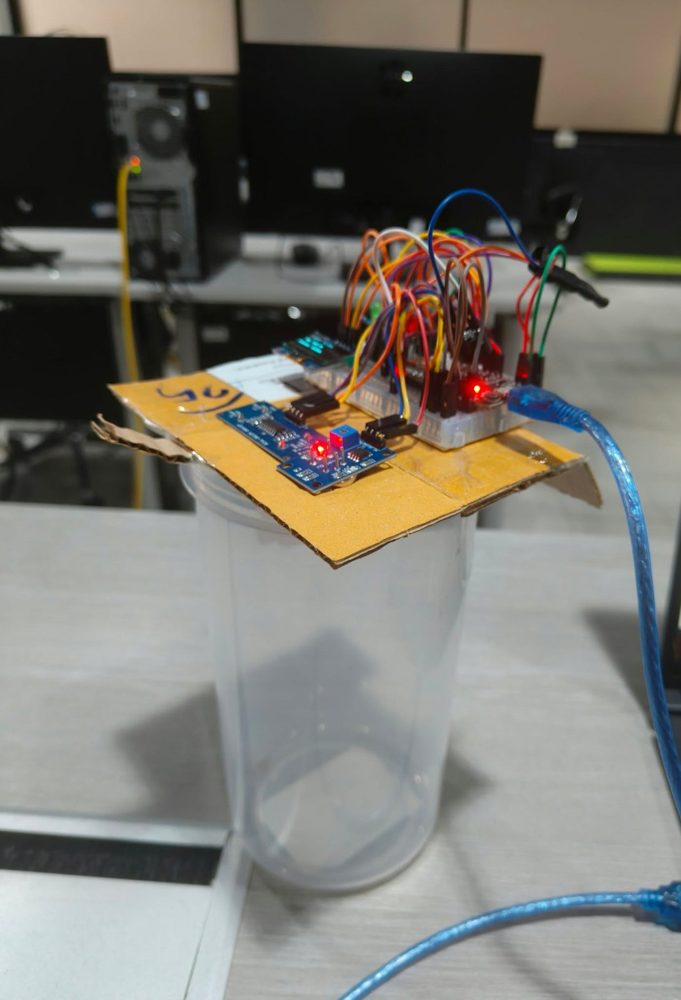
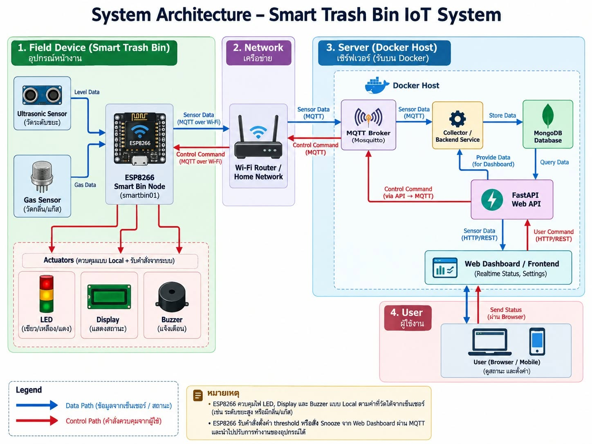

# Smart Trash Bin IoT System

[ภาษาไทย (Thai)](docs/README.th.md)

A university group project. A smart trash bin that measures how full it is and how bad it smells,
warns people with LEDs, a buzzer and an OLED screen, and sends the data to a web dashboard.
You can change the alert thresholds and mute the buzzer from the dashboard.

## Prototype



The working prototype: an ESP8266 on a breadboard with an OLED screen, the distance and smell sensors, and LEDs, mounted on a cardboard lid over a plastic cup. Both sensors face down into the cup.

## How it works



1. An **ESP8266 (NodeMCU)** reads an ultrasonic sensor (**HC-SR04**, fill level) and a gas sensor (**MQ-136**, smell).
   It shows the status on a 3-colour LED, a buzzer and a 0.96" OLED, and publishes the readings over **MQTT** (Wi-Fi).
2. **Mosquitto** is the MQTT broker.
3. A Python **collector** validates each message and stores it in **MongoDB**.
4. A **FastAPI** backend serves the REST API and the web dashboard (port 8081).
5. The dashboard can send new thresholds and commands (snooze, mute, unmute) back to the board through MQTT.

Wiring diagram: [`docs/circuit.png`](docs/circuit.png)

## Features
- Three levels per bin: green (normal), yellow (getting full), red (full or smelly), plus an offline state when a board is silent for 30 s.
- Live dashboard with a floorplan, a bin list, an estimate of when a bin will be full, and an event history.
- Buzzer control: snooze for 5 minutes (turns back on when the bin is emptied), or mute until turned back on (away mode).
- Thresholds for smell and distance can be changed from the web page. They are sent to the board as retained MQTT messages.

## Tech stack
ESP8266 / Arduino (C++) · MQTT (Eclipse Mosquitto) · Python (FastAPI, paho-mqtt, pymongo) · MongoDB 7 ·
HTML / CSS / JavaScript · Docker Compose

## Repository layout
```text
backend/     FastAPI app + dashboard (static/)
collector/   MQTT subscriber that validates and stores readings
database/    MongoDB init script and notes
esp8266/     Board firmware (config.example.h -> copy to config.h)
mqtt/        Mosquitto config
web/         Nginx image that serves the same dashboard files
docs/        Architecture, wiring, MQTT and API design, Thai README
test/        Test report
```

## Run the server
You need Docker. Ports 1883 and 8081 must be free.

```bash
cp .env.example .env
docker compose up -d --build
docker compose ps
```
Then open http://localhost:8081.

## Flash the board
1. In Arduino IDE install the ESP8266 board package and the libraries `Adafruit SSD1306`, `Adafruit GFX Library` and `PubSubClient`.
2. Copy `esp8266/config.example.h` to `esp8266/config.h` and set your Wi-Fi name, password, and the IP address of the PC that runs Docker
   (do not use `localhost`, the board is outside the Docker network). `config.h` is in `.gitignore`.
3. Select **NodeMCU 1.0 (ESP-12E Module)**, pick the COM port, and upload.

## MQTT topics
| Topic | Direction | Payload |
|-------|-----------|---------|
| `smartbin/<bin_id>/data` | board -> server | `{"bin_id","distance","mq_value","hc_full","mq_danger","snoozed","permanent_mute"}` |
| `smartbin/<bin_id>/config` | server -> board (retained) | `{"mq_danger": 650, "full_distance": 5.0}` |
| `smartbin/<bin_id>/command` | server -> board | `{"action": "snooze" \| "permanent_mute" \| "unsnooze"}` |

Details: [`docs/mqtt-design.md`](docs/mqtt-design.md).

## REST API
| Method | Endpoint | What it does |
|--------|----------|--------------|
| GET | `/api/config` | Frontend settings (offline threshold) |
| GET | `/api/bins` | Known bins |
| GET | `/api/bins/{bin_id}/latest` | Latest reading |
| GET | `/api/bins/{bin_id}/history?limit=120` | Recent readings |
| GET / POST | `/api/bins/{bin_id}/threshold` | Read / change the alert thresholds |
| POST | `/api/bins/{bin_id}/snooze` | Mute the buzzer for 5 minutes |
| POST | `/api/bins/{bin_id}/mute_permanent` | Mute until unmuted |
| POST | `/api/bins/{bin_id}/unsnooze` | Turn the buzzer back on |

Details: [`docs/api-design.md`](docs/api-design.md).

## Testing
Test cases and results are in [`test/test_report.md`](test/test_report.md) (in Thai).
The tests were done on the real board and a local Docker setup during the course.
I added input checks later (see below) and tested those only with mocked MongoDB and MQTT, not on the full system.

## Security notes
This was built for a lab or home network and is **not ready for production**:
- The MQTT broker allows anonymous connections and port 1883 is open, so the ESP8266 can connect over Wi-Fi.
  For real use, add a password file, per-device ACLs and TLS.
- The web API has no login. Anyone on the network can change thresholds or mute a bin. Do not expose it to the internet.
- `bin_id` is limited to `A-Za-z0-9_-` (max 32 characters) in the collector and the backend,
  and the dashboard escapes text before showing it.
- Secrets (Wi-Fi, `.env`) are not in the repo. Copy the `*.example` files and edit them.
