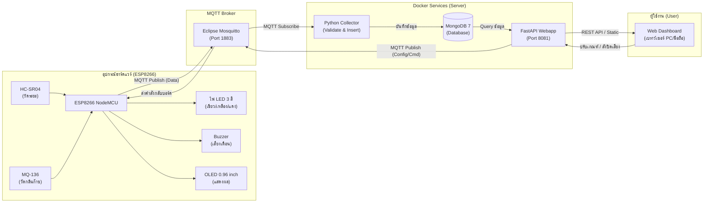

# 🗑️ Smart Trash Bin IoT System (ระบบถังขยะอัจฉริยะแจ้งเตือนระดับและกลิ่น)

ระบบถังขยะอัจฉริยะ IoT ตรวจจับระดับความจุของขยะและกลิ่นไม่พึงประสงค์แบบเรียลไทม์ พร้อมระบบแจ้งเตือนผ่านไฟ LED, เสียงบัซเซอร์, หน้าจอ OLED และ Web Dashboard แบบ Interactive ผังบ้าน (Floorplan) รวมถึงระบบควบคุมเสียงแจ้งเตือนอัจฉริยะ (Snooze & Away Mode)

---

## 📑 สารบัญ (Table of Contents)
1. [ภาพรวมระบบ (System Overview)](#-ภาพรวมระบบ-system-overview)
2. [ส่วนที่ 1: คู่มือการใช้งาน (User Manual)](#-ส่วนที่-1-คู่มือการใช้งาน-user-manual)
   - [1.1 การเข้าใช้งานแดชบอร์ด](#11-การเข้าใช้งานแดชบอร์ด-web-dashboard)
   - [1.2 การอ่านสถานะและสีแจ้งเตือน](#12-การอ่านสถานะและสีแจ้งเตือน)
   - [1.3 แผนผังบ้านและตำแหน่งถังขยะ](#13-แผนผังบ้านและตำแหน่งถังขยะ-floorplan-view)
   - [1.4 ระบบควบคุมเสียงเตือน (Snooze & โหมดไม่อยู่บ้าน)](#14-ระบบควบคุมเสียงเตือน-sound-management)
   - [1.5 การตั้งค่าเกณฑ์แจ้งเตือน](#15-การตั้งค่าเกณฑ์แจ้งเตือน-threshold-settings)
   - [1.6 การดูสถิติและประวัติย้อนหลัง](#16-การดูสถิติและประวัติย้อนหลัง)
3. [ส่วนที่ 2: คู่มือสำหรับนักพัฒนา (Developer Manual)](#-ส่วนที่-2-คู่มือสำหรับนักพัฒนา-developer-manual)
   - [2.1 สถาปัตยกรรมระบบและโครงสร้างไฟล์](#21-สถาปัตยกรรมระบบ-system-architecture)
   - [2.2 แผนผังการต่อวงจรฮาร์ดแวร์ (Hardware Pinout)](#22-แผนผังการต่อวงจรฮาร์ดแวร์-hardware-pinout)
   - [2.3 การติดตั้งและรันเซิร์ฟเวอร์ (Docker Compose)](#23-การติดตั้งและรันเซิร์ฟเวอร์-docker-compose)
   - [2.4 การคอมไพล์และอัปโหลดโค้ดลงบอร์ด ESP8266](#24-การคอมไพล์และอัปโหลดโค้ดลงบอร์ด-esp8266)
   - [2.5 ข้อกำหนด MQTT Topics & Payloads](#25-ข้อกำหนด-mqtt-topics--payloads)
   - [2.6 รายละเอียด REST API (Backend Webapp)](#26-รายละเอียด-rest-api-backend-webapp)
   - [2.7 โครงสร้างฐานข้อมูล MongoDB](#27-โครงสร้างฐานข้อมูล-mongodb-schema)
   - [2.8 การแก้ไขปัญหาที่พบบ่อย (Troubleshooting)](#28-การแก้ไขปัญหาที่พบบ่อย-troubleshooting)

---

## 🌐 ภาพรวมระบบ (System Overview)



---

## 📖 ส่วนที่ 1: คู่มือการใช้งาน (User Manual)

### 1.1 การเข้าใช้งานแดชบอร์ด (Web Dashboard)
เปิดเว็บเบราว์เซอร์ (Chrome, Edge, Safari หรือเบราว์เซอร์บนมือถือ) แล้วพิมพ์ที่อยู่ URL:
```text
http://<IP_เครื่องคอมพิวเตอร์_หรือ_Server>:8081
ตัวอย่างใช้งานบนเครื่องเดียวกัน: http://localhost:8081
```

หน้าจอหลักประกอบด้วย 4 ส่วนสำคัญ:
1. **แถบสรุปสถานะด้านบน (KPI Summary):** แสดงจำนวนถังทั้งหมด, จำนวนถังที่ออนไลน์, จำนวนถังไฟเขียว, ไฟเหลือง และไฟแดง
2. **ผังบ้านจำลอง (Interactive Floorplan):** แสดงห้องต่างๆ และมาร์กเกอร์จุดวางถังขยะพร้อมสีสถานะและวงแหวนกระพริบเตือน
3. **รายการถังขยะ (Bin List):** รายละเอียดของแต่ละถัง (ระยะ, กลิ่น, %, ป้ายสถานะ) พร้อมปุ่มจัดการเสียงเตือน
4. **การคาดการณ์และสถิติ (Forecast & Event Timeline):** เวลาโดยประมาณที่ถังจะเต็ม และประวัติเหตุการณ์ล่าสุด

---

### 1.2 การอ่านสถานะและสีแจ้งเตือน

ระบบจำแนกสถานะการทำงานออกเป็น 3 ระดับ ทั้งบนตัวถังขยะจริง (ไฟ LED / หน้าจอ OLED) และบนหน้าเว็บ:

| ระดับ | สีสถานะ | ความหมาย | พฤติกรรมที่บอร์ดจริง | การแสดงผลบนเว็บ |
| :---: | :---: | :--- | :--- | :--- |
| **ปกติ** | 🟢 **เขียว** | ขยะยังน้อย กลิ่นปกติ | ไฟเขียวติดสว่าง, OLED แสดง `NORMAL` | แถบสีเขียว ปริมาณขยะยังน้อย |
| **ใกล้เต็ม** | 🟡 **เหลือง** | ขยะเกินครึ่งถัง (ระยะ $\le 10$ cm) | ไฟเหลืองติดสว่าง, OLED แสดง `NORMAL` | แถบสีเหลือง ขยะเกินครึ่งถังแล้ว |
| **วิกฤต** | 🔴 **แดง** | **ถังเต็ม** หรือ **มีกลิ่นเหม็นมาก** | ไฟแดงติดสว่าง, บัซเซอร์ส่งเสียงร้องเตือน, OLED แสดง `CHANGE` | มีกรอบสีแดงแจ้งเตือน กระพริบเตือนบนผังบ้าน |
| **ออฟไลน์** | ⚪ **เทา** | บอร์ดขาดการเชื่อมต่อเกิน 30 วินาที | ดับหรือหลุดการเชื่อมต่อ | ป้ายขึ้นว่า "ออฟไลน์" |

---

### 1.3 แผนผังบ้านและตำแหน่งถังขยะ (Floorplan View)
* ผังบ้านจำลองแสดงห้องต่างๆ เช่น ห้องครัว (Kitchen), ห้องนั่งเล่น (Living Room), ห้องนอน (Bedroom), ห้องน้ำ (Bathroom), ระเบียง (Porch)
* ถังขยะแต่ละใบจะมีสัญลักษณ์มาร์กเกอร์ทรงกลมระบุตัวเลขและสีสถานะ
* สามารถ **คลิกที่มาร์กเกอร์ถังขยะ** บนผังบ้าน เพื่อสลับไปดูรายละเอียดของการ์ดถังใบนั้นได้ทันที

---

### 1.4 ระบบควบคุมเสียงเตือน (Sound Management)

เมื่อถังขยะเข้าสู่สถานะ **สีแดง (เต็มหรือมีกลิ่นเหม็น)** บอร์ดจริงจะส่งเสียงบัซเซอร์เตือนอย่างต่อเนื่อง ผู้ใช้งานสามารถควบคุมเสียงเตือนผ่านหน้าเว็บได้ 3 รูปแบบ:

```
+-----------------------------------------------------------------------------------+
|  [สถานะสีแดง: บัซเซอร์กำลังส่งเสียงเตือน]                                         |
|  ปุ่มกดเลือก:                                                                     |
|    1. [ 🔇 ปิด 5 นาที ]           -> โหมด Snooze (เทขยะแล้วเปิดเสียงคืนให้อัตโนมัติ)|
|    2. [ 🏠 ปิดถาวร (ไม่อยู่บ้าน) ] -> โหมด Away (ปิดยาวๆ ไม่จำกัดเวลา)             |
+-----------------------------------------------------------------------------------+
|  [สถานะปิดเสียงอยู่ (Muted)]                                                      |
|    -> [ 🔊 เปิดเสียงคืนทันที ]     -> คืนเสียงเตือนทันทีไม่ต้องรอ                   |
+-----------------------------------------------------------------------------------+
```

#### 1) 🔇 ปิดเสียงชั่วคราว 5 นาที (Snooze Mode)
* **การทำงาน:** กดปุ่ม **`[ 🔇 ปิด 5 นาที ]`** เพื่อปิดเสียงชั่วคราว
* **ไฟสีแดง:** ไฟ LED สีแดงที่ตัวถังและแถบสีแดงบนหน้าเว็บ **ยังคงสว่างเตือนตามปกติ**
* **ระบบเปิดเสียงคืนอัตโนมัติ:** เมื่อนำขยะไปทิ้ง (ระยะพ้นขีดแดง และกลิ่นจางลง) **ระบบจะเปิดเสียงเตือนคืนให้ทันทีโดยอัตโนมัติ** ไม่ต้องรอครบ 5 นาที
* **หากครบ 5 นาทีแล้วขยะยังอยู่:** บอร์ดจะกลับมาส่งเสียงเตือนซ้ำใหม่อีกครั้ง

#### 2) 🏠 ปิดเสียงถาวร (Away Mode / โหมดไม่อยู่บ้าน)
* **การทำงาน:** กดปุ่ม **`[ 🏠 ปิดถาวร (ไม่อยู่บ้าน) ]`**
* **เหมาะสำหรับ:** กรณีไม่มีใครอยู่บ้านหลายวัน หรือช่วงเวลานอนที่ไม่ต้องการให้มีเสียงรบกวน
* **พฤติกรรม:** เสียงเตือนจะถูกปิดยาวต่อเนื่อง **ไม่มีกำหนดเวลาหมดอายุ** แม้จะมีการขยับขยะหรือขยะเต็มเพิ่ม ก็จะไม่มีเสียงดังขึ้นจนกว่าผู้ใช้จะกดเปิดเสียงคืนเอง
* **กดล่วงหน้าได้:** แม้ถังยังเป็นสีเขียว/เหลือง ผู้ใช้ก็สามารถกดปุ่มปิดเสียงถาวรเตรียมไว้ก่อนออกจากบ้านได้

#### 3) 🔊 เปิดเสียงคืนทันที (Unmute)
* เมื่อถังขยะอยู่ในสถานะปิดเสียง (ไม่ว่าจะเป็น Snooze หรือปิดถาวร) จะมีปุ่ม **`[ 🔊 เปิดเสียงคืนทันที ]`** ปรากฏขึ้นมา
* กดเพื่อยกเลิกการปิดเสียงและเปิดระบบส่งเสียงเตือนคืนทันที

---

### 1.5 การตั้งค่าเกณฑ์แจ้งเตือน (Threshold Settings)
ผู้ใช้งานสามารถปรับเกณฑ์ "ระยะถังเต็ม" และ "ระดับกลิ่นเหม็น" จากหน้าเว็บได้โดยตรง โดยไม่ต้องต่อสายแฟลชโค้ดบอร์ดใหม่:
1. กดปุ่ม **`⚙ ตั้งค่าเกณฑ์แจ้งเตือน`** ที่มุมขวาบนของหน้าเว็บ
2. ปรับแถบเลื่อน:
   * **เกณฑ์กลิ่น (MQ-136):** ค่าระหว่าง 0 – 1023 (ค่าเริ่มต้น: 600)
   * **ระยะเต็มถัง (Distance):** ค่าระหว่าง 2.0 – 400.0 cm (ค่าเริ่มต้น: 4.0 cm หมายถึง ขยะพูนขึ้นมาจนเหลือระยะถึงฝาถังน้อยกว่าหรือเท่ากับ 4 cm)
3. ดูแถบสรุปตัวอย่างสีสถานะ (Preview) ก่อนบันทึก
4. กดปุ่ม **"บันทึกเกณฑ์"** ระบบจะส่งค่าไปยังบอร์ดทุกใบผ่าน MQTT Retained Messages ทันที

---

### 1.6 การดูสถิติและประวัติย้อนหลัง
* **ประวัติการแจ้งเตือน (กระดิ่ง 🔔):** แสดงประวัติเหตุการณ์เตือนสีแดง, การกดปิดเสียง Snooze, การกดปิดถาวร และการเปิดเสียงคืน
* **ตารางเหตุการณ์ทั้งหมด:** กดปุ่ม **`📋 ตารางเหตุการณ์`** เพื่อดู Log ตารางละเอียด กรองดูเฉพาะไฟเขียว, เหลือง หรือแดงได้
* **การคาดการณ์เวลาเต็ม (ETA):** คำนวณอัตราความเร็วในการสะสมขยะจากข้อมูลย้อนหลัง เพื่อประมาณการว่าถังขยะจะเต็มในอีกกี่ชั่วโมง/กี่วัน

---

## 🛠️ ส่วนที่ 2: คู่มือสำหรับนักพัฒนา (Developer Manual)

### 2.1 สถาปัตยกรรมระบบ (System Architecture)

โครงสร้างโฟลเดอร์ของโปรเจกต์:
```text
smart_bin/
│
├── README.md                   # คู่มือการใช้งานและเอกสารกำกับระบบ
├── docker-compose.yml          # Docker Compose Orchestration รวมทุก Services
├── .env.example                # ตัวอย่างไฟล์ตั้งค่า (คัดลอกเป็น .env ก่อนรัน)
├── .gitignore                  # กันไฟล์ .env และ config.h (ค่าจริง) ไม่ให้ขึ้น Git
│
├── docs/                       # เอกสารข้อกำหนดและการออกแบบระบบ
│   ├── architecture.png        # แผนผังสถาปัตยกรรมระบบ (System Architecture)
│   ├── circuit.png             # แผนผังวงจรฮาร์ดแวร์ (Circuit Diagram)
│   ├── mqtt-design.md          # เอกสารการออกแบบ MQTT Topics & Payloads
│   └── api-design.md           # เอกสารการออกแบบ RESTful Web API
│
├── esp8266/                    # เฟิร์มแวร์สำหรับบอร์ด ESP8266 NodeMCU
│   ├── config.example.h        # ตัวอย่าง WiFi SSID, Pass, MQTT IP, Pinout (คัดลอกเป็น config.h)
│   └── esp8266.ino             # Source Code หลักสำหรับ Arduino IDE
│
├── mqtt/                       # MQTT Broker Service (Mosquitto)
│   └── mosquitto.conf          # คอนฟิกการทำงานของ Mosquitto Broker
│
├── backend/                    # FastAPI Application & Web API
│   ├── Dockerfile
│   ├── requirements.txt
│   ├── app.py                  # REST Endpoints & MQTT Publisher
│   └── static/                 # ไฟล์หน้าเว็บแดชบอร์ด (HTML/CSS/JS)
│
├── collector/                  # Data Collector Service
│   ├── Dockerfile
│   ├── requirements.txt
│   └── collector.py            # ตรวจสอบความถูกต้องและบันทึกข้อมูลลง MongoDB
│
├── database/                   # MongoDB Database Service
│   ├── init-mongo.js           # สคริปต์สร้าง Database, Collections & Indexes
│   └── README.md               # เอกสารอธิบาย Schema และ Index
│
├── web/                        # Web Dashboard Frontend (Nginx Standalone)
│   ├── Dockerfile              # Dockerfile สำหรับ Nginx Alpine
│   ├── nginx.conf              # Nginx Reverse Proxy Config
│   ├── index.html              # Single Page Interactive Dashboard
│   ├── css/style.css           # สไตล์ชีต CSS
│   └── js/app.js               # สคริปต์การทำงานของแดชบอร์ด
│
└── test/                       # รายงานและการทดสอบระบบ
    └── test_report.md          # รายงานผลการทดสอบระบบ (Test Verification Report)
```

---

### 2.2 แผนผังการต่อวงจรฮาร์ดแวร์ (Hardware Pinout)

ตารางการเชื่อมต่อขาอุปกรณ์กับบอร์ด **ESP8266 NodeMCU v1.0**:

| อุปกรณ์ / โมดูล | ขาของอุปกรณ์ | ขาบนบอร์ด ESP8266 | คำอธิบาย / หมายเหตุ |
| :--- | :--- | :--- | :--- |
| **HC-SR04** (เซนเซอร์วัดระยะ) | VCC | `VIN` หรือ `5V` | ไฟเลี้ยง 5V |
| | GND | `GND` | กราวด์ร่วม |
| | TRIG | `D6` (GPIO 12) | ขาส่งสัญญาณคลื่นเสียง Trigger |
| | ECHO | `D7` (GPIO 13) | ขารับสัญญาณคลื่นเสียงสะท้อน Echo |
| **MQ-136** (เซนเซอร์ตรวจจับก๊าซ) | VCC | `VIN` หรือ `5V` | ไฟเลี้ยง 5V (ต้องการความร้อน Heater) |
| | GND | `GND` | กราวด์ร่วม |
| | AOUT | `A0` (ADC 0) | ขาอนาล็อก อ่านค่าแรงดัน 0 – 1.0V (0-1023) |
| **OLED 0.96"** (I2C SSD1306) | VCC | `3V3` หรือ `5V` | ไฟเลี้ยง |
| | GND | `GND` | กราวด์ร่วม |
| | SCL | `D3` (GPIO 0) | I2C Clock Pin |
| | SDA | `D4` (GPIO 2) | I2C Data Pin |
| **LED Indicators** (ไฟแสดงสถานะ) | Red Anode (+) | `D1` (GPIO 5) | ผ่านตัวต้านทาน 220 $\Omega$ เข้ากราวด์ |
| | Yellow Anode (+) | `D2` (GPIO 4) | ผ่านตัวต้านทาน 220 $\Omega$ เข้ากราวด์ |
| | Green Anode (+) | `D5` (GPIO 14) | ผ่านตัวต้านทาน 220 $\Omega$ เข้ากราวด์ |
| **Buzzer** (ลำโพงส่งเสียงเตือน) | Positive (+) | `D0` (GPIO 16) | ส่งความถี่ 2,500 Hz ผ่านฟังก์ชัน `tone()` |
| | Negative (-) | `GND` | กราวด์ร่วม |

---

### 2.3 การติดตั้งและรันเซิร์ฟเวอร์ (Docker Compose)

#### ข้อกำหนดเบื้องต้น (Prerequisites):
* ติดตั้ง [Docker Desktop](https://www.docker.com/products/docker-desktop/) บน Windows / macOS / Linux
* ตรวจสอบว่าพอร์ต `1883` (MQTT) และ `8081` (Web Dashboard) ยังไม่มีโปรแกรมอื่นใช้งาน

#### ขั้นตอนการติดตั้ง:
1. คัดลอก `.env.example` เป็น `.env` ที่โฟลเดอร์หลัก (Root) ของโปรเจกต์ (`cp .env.example .env`) แล้วตรวจสอบค่า:
   ```ini
   MQTT_BROKER=mqtt
   MQTT_PORT=1883
   MQTT_TOPIC=smartbin/+/data
   MQTT_CONFIG_TOPIC_PREFIX=smartbin
   MONGO_URL=mongodb://mongodb:27017
   MONGO_DB_NAME=smartbin_db
   MONGO_COLLECTION_NAME=smartbin_readings
   MONGO_THRESHOLD_COLLECTION_NAME=smartbin_thresholds
   KNOWN_BINS=smartbin01
   BIN_OFFLINE_THRESHOLD_SECONDS=30
   MQ_DANGER_DEFAULT=600
   FULL_DISTANCE_DEFAULT=4.0
   ```
2. สั่งคอมไพล์และเปิดเซอร์วิสทั้งหมดจาก Root Directory:
   ```bash
   docker compose up -d --build
   ```
3. ตรวจสอบสถานะการทำงานของคอนเทนเนอร์:
   ```bash
   docker compose ps
   ```
   *คอนเทนเนอร์หลัก (`mqtt`, `mongodb`, `collector`, `backend`) ต้องอยู่ในสถานะ `Up` หรือ `Running`*

---

### 2.4 การคอมไพล์และอัปโหลดโค้ดลงบอร์ด ESP8266

#### 1) การติดตั้ง Library ใน Arduino IDE
เปิด **Arduino IDE** (เวอร์ชัน 1.8.x หรือ 2.x) ไปที่เมนู **Sketch > Include Library > Manage Libraries...** แล้วติดตั้ง:
1. `Adafruit SSD1306` (โดย Adafruit)
2. `Adafruit GFX Library` (โดย Adafruit)
3. `PubSubClient` (โดย Nick O'Leary)
4. ติดตั้ง ESP8266 Board Package ผ่าน Board Manager: URL `http://arduino.esp8266.com/stable/package_esp8266com_index.json`

#### 2) ปรับแต่งการเชื่อมต่อใน `esp8266/config.h`
คัดลอก `esp8266/config.example.h` เป็น `esp8266/config.h` (ไฟล์นี้ถูก `.gitignore` ไว้ เพื่อไม่ให้รหัส WiFi ขึ้น GitHub) แล้วแก้ไขชื่อ WiFi และ IP ของเครื่อง Server:
```cpp
// ชื่อและรหัสผ่าน WiFi ที่บอร์ดจะต่อ
#define WIFI_SSID "Your_WiFi_SSID"
#define WIFI_PASSWORD "Your_WiFi_Password"

// IP Address ของเครื่องคอมพิวเตอร์ที่รัน Docker
// (ดูได้จากคำสั่ง ipconfig ใน Command Prompt / PowerShell)
#define MQTT_BROKER "192.168.1.100"
#define MQTT_PORT 1883

// รหัสประจำตัวถังขยะ
#define BIN_ID "smartbin01"
```

#### 3) ตั้งค่า Board และ Upload
* เลือกบอร์ด: **Tools > Board > ESP8266 Boards > NodeMCU 1.0 (ESP-12E Module)**
* เลือกพอร์ต: **Tools > Port > COM...** (เช็คจาก Device Manager เช่น Silicon Labs CP210x หรือ CH340)
* กดปุ่ม **Upload (ลูกศรขวา ➔)** แล้วรอจนขึ้น `Done uploading`

---

### 2.5 ข้อกำหนด MQTT Topics & Payloads

ระบบใช้ MQTT ในการสื่อสารแบบสองทิศทาง (Bi-directional Communication):

#### 1. Telemetry Data (บอร์ดส่งขึ้นเซิร์ฟเวอร์)
* **Topic:** `smartbin/<BIN_ID>/data` (ตัวอย่าง: `smartbin/smartbin01/data`)
* **Interval:** ทุกๆ ~300 ms (ตามรอบลูป `PUBLISH_INTERVAL_MS`)
* **Payload JSON:**
```json
{
  "bin_id": "smartbin01",
  "distance": 3.8,
  "mq_value": 265,
  "hc_full": true,
  "mq_danger": false,
  "snoozed": false,
  "permanent_mute": false
}
```

#### 2. Configuration Settings (เซิร์ฟเวอร์ส่งเกณฑ์ใหม่ให้บอร์ด)
* **Topic:** `smartbin/<BIN_ID>/config` (ตัวอย่าง: `smartbin/smartbin01/config`)
* **Flags:** `retain=True` (เพื่อให้บอร์ดที่เพิ่งเปิดขึ้นมาได้รับค่าล่าสุดทันที)
* **Payload JSON:**
```json
{
  "mq_danger": 650,
  "full_distance": 5.0
}
```

#### 3. Command Actions (เซิร์ฟเวอร์ส่งคำสั่งควบคุมบอร์ด)
* **Topic:** `smartbin/<BIN_ID>/command` (ตัวอย่าง: `smartbin/smartbin01/command`)
* **Flags:** `retain=False` (คำสั่งทำงานครั้งเดียว ไม่ค้าง)
* **Payload JSON:**
  * ปิดเสียง 5 นาที (Snooze): `{"action": "snooze"}`
  * ปิดเสียงถาวร (ไม่อยู่บ้าน): `{"action": "permanent_mute"}`
  * เปิดเสียงเตือนคืนทันที: `{"action": "unsnooze"}`

---

### 2.6 รายละเอียด REST API (Backend Webapp)

FastAPI ให้บริการ RESTful API บนพอร์ต `8081`:

| Method | Endpoint | คำอธิบาย | ข้อมูลที่ส่ง / Body | ตัวอย่างผลลัพธ์ (Response) |
| :--- | :--- | :--- | :--- | :--- |
| `GET` | `/api/config` | ดึงค่าคอนฟิกเริ่มต้นของระบบ | - | `{"known_bins": ["smartbin01"], "offline_threshold_seconds": 30}` |
| `GET` | `/api/bins` | รายชื่อถังทั้งหมดที่รู้จัก | - | `["smartbin01"]` |
| `GET` | `/api/bins/{bin_id}/latest` | ข้อมูลเซนเซอร์ล่าสุดของถัง | - | `{"bin_id": "smartbin01", "distance": 4.1, "mq_value": 310, "hc_full": false, "snoozed": false, "permanent_mute": false, "received_at": "..."}` |
| `GET` | `/api/bins/{bin_id}/history` | ข้อมูลย้อนหลังเพื่อวาดกราฟ | Query: `limit=120` | Array ของ readings ย้อนหลัง เรียงจากใหม่ไปเก่า |
| `GET` | `/api/bins/{bin_id}/threshold` | เกณฑ์แจ้งเตือนปัจจุบัน | - | `{"bin_id": "smartbin01", "mq_danger": 600, "full_distance": 4.0}` |
| `POST` | `/api/bins/{bin_id}/threshold` | ปรับเกณฑ์แจ้งเตือนใหม่ | `{"mq_danger": 650, "full_distance": 5.0}` | `{"saved": true, "published_to_device": true, ...}` |
| `POST` | `/api/bins/{bin_id}/snooze` | ปิดเสียงชั่วคราว 5 นาที | `{}` หรือ `{"action": "snooze"}` | `{"sent": true, "bin_id": "smartbin01", "action": "snooze"}` |
| `POST` | `/api/bins/{bin_id}/mute_permanent` | ปิดเสียงถาวร (ไม่อยู่บ้าน) | - | `{"sent": true, "bin_id": "smartbin01", "action": "permanent_mute"}` |
| `POST` | `/api/bins/{bin_id}/unsnooze` | ยกเลิกปิดเสียงและคืนเสียงทันที | - | `{"sent": true, "bin_id": "smartbin01", "action": "unsnooze"}` |

---

### 2.7 โครงสร้างฐานข้อมูล (MongoDB Schema)

ฐานข้อมูลชื่อ: `smartbin_db` ประกอบด้วย 2 คอลเลกชันหลัก:

#### 1. คอลเลกชัน `smartbin_readings` (เก็บข้อมูลเซนเซอร์ทุกรอบ)
```javascript
{
  "_id": ObjectId("6ab8c8028c03bd97a117a2b2"),
  "bin_id": "smartbin01",
  "distance": 3.8,               // Double (cm)
  "mq_value": 265,               // Int (0-1023)
  "hc_full": true,               // Boolean
  "mq_danger": false,            // Boolean
  "snoozed": false,              // Boolean (true เมื่อเสียงเงียบอยู่)
  "permanent_mute": false,       // Boolean (true เมื่ออยู่ในโหมดไม่อยู่บ้าน)
  "received_at": ISODate("2026-09-27T08:52:15.000Z") // วันเวลาที่บันทึก
}
```
* **Indexes:** `[("bin_id", 1), ("received_at", -1)]` เพื่อเพิ่มความเร็วในการ Query ประวัติย้อนหลัง

#### 2. คอลเลกชัน `smartbin_thresholds` (เก็บเกณฑ์แจ้งเตือนล่าสุด)
```javascript
{
  "_id": ObjectId("..."),
  "bin_id": "smartbin01",
  "mq_danger": 600,
  "full_distance": 4.0,
  "updated_at": ISODate("2026-09-27T07:15:00.000Z")
}
```
* **Indexes:** `bin_id` (Unique Index)

---

### 2.8 การแก้ไขปัญหาที่พบบ่อย (Troubleshooting)

#### 1. บอร์ด ESP8266 เชื่อมต่อ WiFi ไม่ได้
* ตรวจสอบว่า WiFi ที่ใช้งานเป็นย่านความถี่ **2.4 GHz** เท่านั้น (ESP8266 ไม่รองรับ WiFi 5 GHz)
* ตรวจสอบ `WIFI_SSID` และ `WIFI_PASSWORD` ใน `esp8266/config.h` ว่าถูกต้องครบถ้วน

#### 2. บอร์ดเชื่อมต่อ WiFi ได้ แต่ขึ้น "MQTT Connect Failed, rc=-2"
* ค่า `rc=-2` หมายถึงไม่สามารถเชื่อมต่อไปยัง IP ของ MQTT Broker ได้
* ตรวจสอบว่าใน `esp8266/config.h` ตั้งค่า `MQTT_BROKER` เป็น IP จริงของเครื่อง PC (เช่น `192.168.x.x`) ห้ามตั้งเป็น `localhost` หรือ `mqtt`
* ตรวจสอบว่า Windows Defender Firewall ไม่ได้บล็อกพอร์ต `1883`

#### 3. หน้าเว็บขึ้นสถานะบอร์ด "ออฟไลน์" ตลอดเวลา
* ตรวจสอบในคอนเทนเนอร์ `smart_bin-collector-1` ผ่านคำสั่ง:
  ```bash
  docker logs -f smart_bin-collector-1
  ```
  หากขึ้น `[VALIDATION] ข้อมูลไม่ผ่านการตรวจสอบ` ให้ดูสาเหตุว่าฟิลด์ตัวเลขใดอยู่นอกช่วงที่กำหนด

#### 4. สั่งกดปิดเสียงบนหน้าเว็บแล้ว บอร์ดจริงไม่เงียบ
* ตรวจสอบว่าได้นำโค้ดใน [esp8266.ino](file:///C:/Users/ASUS/Downloads/smart_bin_ready/smart_bin/esp8266/esp8266.ino) ล่าสุดไปกด Upload ลงตัวบอร์ดหรือยัง
* ตรวจสอบ Serial Monitor ใน Arduino IDE (Baud rate 115200) ว่าบอร์ดได้รับข้อความจาก topic `smartbin/smartbin01/command` หรือไม่

---


---

## 🔒 หมายเหตุด้านความปลอดภัย (Security Notes)
โปรเจกต์นี้ออกแบบมาสำหรับใช้งานในเครือข่ายแลบ/บ้านเท่านั้น ยังไม่พร้อมสำหรับ production:
- **MQTT broker** เปิด `allow_anonymous true` และเปิดพอร์ต 1883 เพื่อให้บอร์ด ESP8266 ต่อผ่าน WiFi ได้ ถ้าจะใช้งานจริงควรตั้ง `password_file`, ACL ต่อบอร์ด และ TLS
- **Web API ไม่มีระบบ login** ใครที่เข้าถึงเครือข่ายได้ก็สั่ง snooze/ตั้งค่า threshold ได้ ไม่ควรเปิดออกอินเทอร์เน็ตโดยตรง
- `bin_id` ถูกจำกัดเป็น `A-Za-z0-9_-` ไม่เกิน 32 ตัวอักษร ทั้งใน collector และ backend และหน้าเว็บ escape ข้อความก่อนแสดงผลทุกครั้ง
- ค่าลับ (WiFi, `.env`) ไม่อยู่ใน repo ให้คัดลอกจาก `*.example` แล้วแก้เอง
