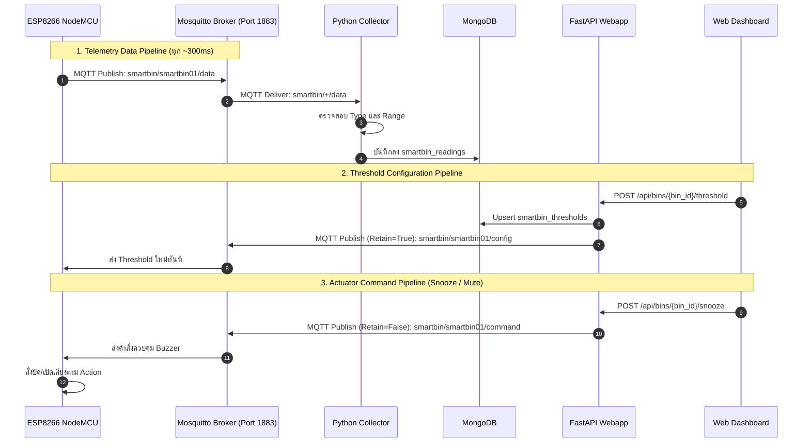

# 📡 MQTT Communication Design

เอกสารฉบับนี้อธิบายรายละเอียดการออกแบบการสื่อสารผ่านโปรโตคอล **MQTT (Message Queuing Telemetry Transport)** สำหรับระบบ **Smart Bin IoT System** ตามข้อกำหนดในเอกสารข้อกำหนดความต้องการ (Requirement Specification)

---

## 🏗️ 1. ภาพรวมการเชื่อมต่อ (MQTT Architecture)

ระบบเลือกใช้ **Eclipse Mosquitto 2.x** เป็น MQTT Broker ซึ่งทำงานเป็นคอนเทนเนอร์บน Docker (Port 1883) ทำหน้าที่เป็นศูนย์กลางกระจายข้อมูลระหว่างอุปกรณ์ฮาร์ดแวร์ (ESP8266) และระบบฝั่งเซิร์ฟเวอร์ (Collector และ Backend Webapp)



---

## 📋 2. รายการ MQTT Topics

| Topic Pattern | ทิศทาง (Direction) | QoS | Retain Flag | หน้าที่และคำอธิบาย |
| :--- | :--- | :---: | :---: | :--- |
| `smartbin/+/data` | ESP8266 $\rightarrow$ Collector | 0 | `False` | Collector ใช้ Wildcard `+` เพื่อ Subscribe ข้อมูลจากถังขยะทุกใบในระบบ |
| `smartbin/{bin_id}/data` | ESP8266 $\rightarrow$ Server | 0 | `False` | บอร์ดส่งข้อมูลเซนเซอร์ (Distance, MQ, Status Flags) ของถังนั้นๆ ขึ้นเซิร์ฟเวอร์ |
| `smartbin/{bin_id}/config` | Webapp $\rightarrow$ ESP8266 | 0 | `True` | เซิร์ฟเวอร์ส่งค่าเกณฑ์แจ้งเตือนใหม่ (Retain=True เพื่อให้บอร์ดที่เพิ่งเปิดได้ค่าทันที) |
| `smartbin/{bin_id}/command` | Webapp $\rightarrow$ ESP8266 | 0 | `False` | เซิร์ฟเวอร์ส่งคำสั่งควบคุมการทำงานฉับพลัน (เช่น Snooze หรือ Permanent Mute) |

---

## 📦 3. รูปแบบข้อมูล (MQTT Payload Design)

### 3.1 ข้อมูลเซนเซอร์ (Telemetry Data)
* **Topic:** `smartbin/<BIN_ID>/data`
* **ความถี่:** ทุก ~300 ms (ตามรอบลูป `PUBLISH_INTERVAL_MS`)
* **Format:** JSON String

#### โครงสร้างฟิลด์:
| ฟิลด์ (Field) | ชนิดข้อมูล | ช่วงค่าที่ถูกต้อง (Valid Range) | คำอธิบาย |
| :--- | :--- | :--- | :--- |
| `bin_id` | String | ความยาว 1-32 ตัวอักษร | รหัสประจำตัวถังขยะ (เช่น `"smartbin01"`) |
| `distance` | Float | 0.0 – 400.0 cm | ระยะห่างจากเซนเซอร์ถึงผิวขยะ (วัดโดย HC-SR04) |
| `mq_value` | Integer | 0 – 1023 | ค่าแรงดันอนาล็อกจากเซนเซอร์ตรวจจับก๊าซ MQ-136 |
| `hc_full` | Boolean | `true` หรือ `false` | ธงสถานะ: ระยะน้อยกว่าเกณฑ์ที่กำหนด (ถังเต็ม) |
| `mq_danger` | Boolean | `true` หรือ `false` | ธงสถานะ: ค่ากลิ่นสูงกว่าเกณฑ์ที่กำหนด (กลิ่นวิกฤต) |
| `snoozed` | Boolean | `true` หรือ `false` | ธงสถานะ: กำลังอยู่ในโหมดปิดเสียงชั่วคราว 5 นาที |
| `permanent_mute`| Boolean | `true` หรือ `false` | ธงสถานะ: กำลังอยู่ในโหมดปิดเสียงถาวร (ไม่อยู่บ้าน) |

#### ตัวอย่าง Payload:
```json
{
  "bin_id": "smartbin01",
  "distance": 3.8,
  "mq_value": 265,
  "hc_full": true,
  "mq_danger": false,
  "snoozed": false,
  "permanent_mute": false
}
```

---

### 3.2 ค่าเกณฑ์แจ้งเตือน (Threshold Configuration)
* **Topic:** `smartbin/<BIN_ID>/config`
* **คุณลักษณะสำคัญ:** `retain = True`
* **Format:** JSON String

#### โครงสร้างฟิลด์:
| ฟิลด์ (Field) | ชนิดข้อมูล | ค่าเริ่มต้น | คำอธิบาย |
| :--- | :--- | :--- | :--- |
| `mq_danger` | Integer | `600` | เกณฑ์ค่า MQ-136 ที่ถือว่าเป็นอันตราย/มีกลิ่นเหม็นมาก |
| `full_distance` | Float | `4.0` | เกณฑ์ระยะเซนเซอร์ (ซม.) ที่ถือว่าขยะพูนเต็มถังแล้ว |

#### ตัวอย่าง Payload:
```json
{
  "mq_danger": 650,
  "full_distance": 5.0
}
```

---

### 3.3 คำสั่งควบคุมอุปกรณ์ (Command Actions)
* **Topic:** `smartbin/<BIN_ID>/command`
* **คุณลักษณะสำคัญ:** `retain = False` (ทำงานครั้งเดียว ไม่ค้างในระบบ)
* **Format:** JSON String

#### การใช้งานและตัวอย่าง Payload:
1. **ปิดเสียงเตือนชั่วคราว 5 นาที (Snooze):**
   ```json
   {"action": "snooze"}
   ```
2. **ปิดเสียงเตือนถาวร (โหมดไม่อยู่บ้าน / Away Mode):**
   ```json
   {"action": "permanent_mute"}
   ```
3. **เปิดเสียงเตือนคืนทันที (Unmute / ยกเลิกการปิดเสียง):**
   ```json
   {"action": "unsnooze"}
   ```

---

## ⚙️ 4. การจัดการความเสถียรของเครือข่าย (Reliability & Fault Tolerance)

1. **Keep Alive:** ตั้งค่า `keepalive = 60` วินาที
2. **Auto-Reconnect (ESP8266):**
   * หากหลุดจาก Wi-Fi หรือ MQTT Broker ฟังก์ชันลูปจะพยายาม Reconnect อัตโนมัติทุกรอบ โดยไม่ทำให้การอ่านเซนเซอร์สะดุด
3. **Data Validation (Collector):**
   * Collector จะทำการตรวจสอบ Type และ Range ก่อนบันทึกลง MongoDB เสมอ หากข้อมูลผิดเพี้ยนจะไม่ถูกนำไปบันทึก
4. **Offline Detection:**
   * หากไม่มีข้อมูลส่งมาจากถังขยะเกิน 30 วินาที ระบบจะเปลี่ยนสถานะเป็น `OFFLINE` อัตโนมัติบนแดชบอร์ด
